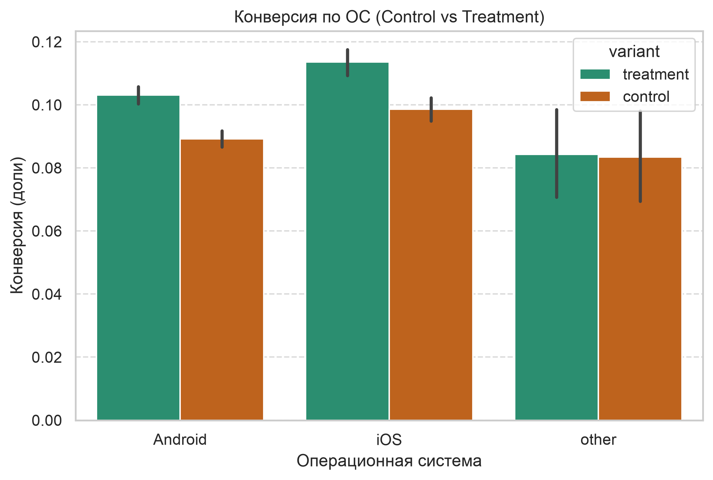

# Анализ A/B-теста новой фичи (Conversion Experiment)

## 📌 О проекте
Данный проект представляет собой анализ результатов A/B-теста, проведенного для оценки влияния новой фичи (Treatment) на конверсию пользователей по сравнению с текущей версией (Control). 
**Данные:** Датасет находится в репозитории ('ab_test_dataset.csv'). Оригинал доступен на Kaggle [Ссылка на датасет Kaggle](https://www.kaggle.com/datasets/ignaciospreafico/ab-testing-dataset-conversion-experiment?resource=download&select=data_dictionary.csv)

## 🎯 Бизнес-задача
Определить, увеличивает ли новая фича конверсию. Выявить сегменты пользователей, на которых фича работает лучше или хуже. Сформулировать рекомендации для продуктовой команды.

## 🛠 Инструменты
*   **Python:** Pandas, NumPy
*   **Визуализация:** Matplotlib, Seaborn
*   **Статистика:** Statsmodels (Z-тест для пропорций)

## 🔍 Этапы исследования
1.  **Data Profiling:** Проведена первичная разведка данных. Выявлено, что пропуски в `conversion_date` и `prior_30d_sessions` являются логическими (пользователь не конвертировался или является новым), поэтому они не удалялись и не заполнялись.
2.  **Sanity Check:** Проверен баланс групп (75 000 на 75 000). Дубликатов `user_id` нет. Тест валиден.
3.  **Оценка эффекта:** Базовая конверсия в Control составила 9.21%, в Treatment — 10.61% (прирост +1.4 п.п.).
4.  **Статистическая проверка:** Проведен Z-тест для пропорций. Получено `p-value < 0.0001`. Результат статистически значим.
5.  **Сегментный анализ (по ОС):** Выявлено, что фича дает прирост на Android (+1.4 п.п.) и iOS (+1.5 п.п.), но не работает на ОС "Other".
6.  **Анализ аномалий (Германия):** В Германии зафиксирован наименьший прирост конверсии. Проверены гипотезы: технические сбои (провалов трафика нет) и разная активность пользователей (группы сбалансированы). Причина не выявлена в рамках датасета, требуются дополнительные логи.

## 📈 Результаты и Рекомендации

**Выводы:**
1. Новая фича статистически значимо увеличивает общую конверсию.
2. Фича показывает отличные результаты на мобильных платформах (Android, iOS).

**Рекомендации для бизнеса:**
1. **Внедрить** новую фичу для пользователей Android и iOS.
2. Для группы "Other" провести технический аудит: возможно, фича там не поддерживается.
3. Запросить у инженеров данные о маркетинговых кампаниях или технических логах в Германии, чтобы понять причину аномально низкого прироста.
